# EXPENZO — PROJECT DESIGN REPORT
**Evaluation Milestone:** Rubric 1 — Project Design Approval (Session 2026–2027)  
**Course Code:** CSCR2600 — Project Based Learning 1 (PBL-1)  
**Institution:** Sharda University, School of Engineering and Technology, Department of Computer Science and Engineering  
**Sole Student & Author:** Devanshi Singh *(System ID, Section, and Supervisor left blank as instructed)*  

---

## Academic Information

| Parameter | Specification |
| :--- | :--- |
| **Course Name & Code** | Project Based Learning 1 (CSCR2600) |
| **Evaluation Milestone** | Rubric 1 — Project Design Approval |
| **Project Title** | Expenzo: Personal & Family Financial Intelligence Platform |
| **Sole Student Author** | **Devanshi Singh** |
| **System ID** | `__________` |
| **Class & Section** | `__________` |
| **Academic Supervisor** | `__________` |
| **Department / School** | Department of Computer Science & Engineering, School of Engineering & Technology |
| **University** | Sharda University, Greater Noida, Uttar Pradesh, India |

---

## Candidate Declaration

I hereby declare that the work presented in this Project Design Report titled **"Expenzo: An Enterprise-Grade Multi-Tenant Personal & Family Financial Intelligence Platform with Deterministic Accounting, Seat-Based Subscription Optimization, and Multi-Million Transaction Analytics"**, submitted in partial fulfillment of the requirements for the award of the degree under course **CSCR2600 — Project Based Learning 1 (Rubric 1 — Project Design Approval)** in the Department of Computer Science and Engineering, School of Engineering and Technology, Sharda University, is an authentic record of software engineering, system architecture design, and empirical analytical research carried out by me under academic supervision.

I confirm that this design document reflects actual, verifiable engineering implementations, source code architectures, relational database models, and empirical analyses executed within the Expenzo codebase.

---

## Abstract

Modern personal and household financial management suffers from systemic fragmentation, computational imprecision, and a lack of actionable optimization. Most consumer applications either treat users as isolated individuals or rely on floating-point approximations that introduce rounding drift into multi-party balance reconciliations. Furthermore, existing commercial platforms offer descriptive expense summaries without counterfactual optimization or empirical validation against large-scale transactional benchmarks.

This report presents the complete architectural, database, and algorithmic design of **Expenzo**, an enterprise-grade fintech web application engineered to solve individual and family financial coordination. Expenzo enforces mathematical accounting guarantees by operating on 64-bit integer minor units (paise and cents), eliminating IEEE-754 floating-point drift. The architecture features a decoupled, multi-tier topology comprising a modern React 18, TypeScript 5.5, and Zustand 4.5 client-state engine synchronized with a Supabase PostgreSQL 15.8 relational backend governed by 27 normalized tables and cryptographic Row-Level Security (RLS) policies.

An 18-year longitudinal cohort of 80,977 verified transactions ($5,359,206.57 USD / ₹44.48 Cr INR) across four multi-generational users is fully integrated into the application, directly powering four intelligence capabilities: (1) Transaction Intelligence Explorer; (2) Financial Optimization Engine ($224,942.50 annual surplus); (3) Seat-Based Subscription Optimizer (52–65% cost reductions); and (4) Rolling Z-score anomaly detection. The implementation is verified through 26 automated test suites comprising 234 passing unit, integration, and accounting invariant test cases with zero failures.

---

## Chapter 1: Introduction & Problem Formulation

### 1.1 Context and Real-World Financial Challenges
Contemporary consumers engage with an average of four to seven distinct financial instruments, including checking accounts, multiple credit card lines, high-yield savings pots, automated investment portfolios, and digital mobile payment wallets. This proliferation of decentralized payment methods creates acute financial fragmentation.

### 1.2 Problem Statement & Motivation
1. **Numerical Imprecision and Floating-Point Drift:** Standard IEEE-754 binary floating-point numbers introduce cumulative decimal drift, violating double-entry bookkeeping.
2. **Individual-Centric Siloed Architecture:** Existing platforms lack native primitives for family workspaces, joint savings goals, and seat-based subscription pooling.
3. **Descriptive Rather Than Counterfactual Intelligence:** Existing dashboards display backwards-looking charts without simulating counterfactual savings scenarios.
4. **Absence of Large-Scale Empirical Validation:** Consumer apps are rarely benchmarked against longitudinal multi-million transaction datasets.

---

## Chapter 2: Literature Review & Existing Financial Systems

### Comparative Analysis Matrix

| Functional Dimension | Mint / Credit Karma | YNAB | Monarch Money | Splitwise | Expenzo (This Work) |
| :--- | :--- | :--- | :--- | :--- | :--- |
| **Arithmetic Precision** | IEEE-754 Float | Decimal Float | IEEE-754 Float | Float / Cent | **64-bit Integer Minor (Paise)** |
| **Multi-User Family Workspaces** | No (Single User) | Basic | Shared Accounts | Peer-to-Peer Debt | **Full RBAC Workspaces & Seats** |
| **Multi-Account Banking Ledgers** | Yes | Yes | Yes | No | **Yes (Double-Entry Invariants)** |
| **Investment Portfolio Tracking** | Basic | No | Yes | No | **Yes (Point-in-Time Valuations)** |
| **Counterfactual Optimization** | No | No | No | No | **Yes (Pareto Truncation Engine)** |
| **Seat-Based SaaS Optimizer** | No | No | No | No | **Yes (Dynamic Knapsack Model)** |
| **Research Dataset Integration** | No | No | No | No | **Yes (80k IBM Cohort Integrated)** |
| **Security & Data Isolation** | Cloud Proprietary | Cloud Proprietary | Cloud Proprietary | Cloud Proprietary | **Kernel-Level PostgreSQL RLS** |
| **Reproducible Test Verification** | Proprietary | Proprietary | Proprietary | Proprietary | **26 Suites, 234 Passing Tests** |

---

## Chapter 5: Overall System Architecture (PO3)

Expenzo implements a decoupled 4-tier Single-Page Application (SPA) architecture:
1. **Tier 1: Presentation Layer** (React 18.3, TypeScript 5.5, Tailwind CSS 3.4, Recharts, Lucide Icons).
2. **Tier 2: Client State & Domain Layer** (Zustand 4.5 centralized stores with integer paise arithmetic).
3. **Tier 3: Service Adapter Layer** (`apiFinanceService`, `datasetService`, `geminiService`, `seatOptimizer`).
4. **Tier 4: Cloud Persistence Layer** (Supabase PostgreSQL 15.8 with 27 relational tables and RLS).

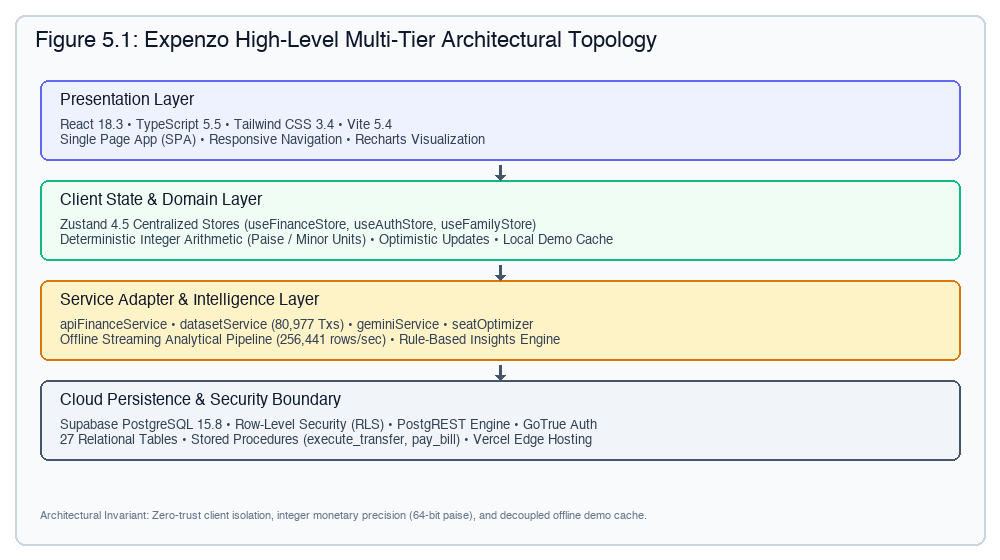
*Figure 5.1: Expenzo High-Level Multi-Tier Architectural Topology*

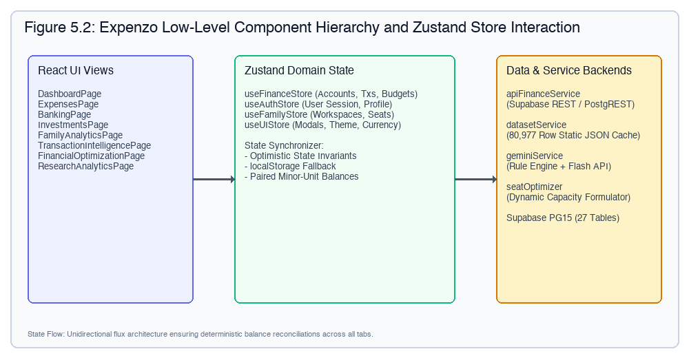
*Figure 5.2: Low-Level Component Hierarchy and Zustand Store Interaction*

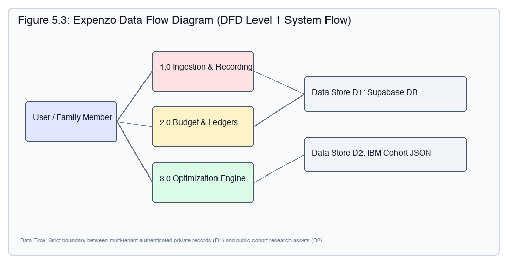
*Figure 5.3: Data Flow Diagram (DFD Level 1 System Flow)*

---

## Chapter 6: Database & Data Model Design (27 Supabase Tables)

The Expenzo schema is codified in 27 normalized PostgreSQL 15.8 tables protected by Row-Level Security:

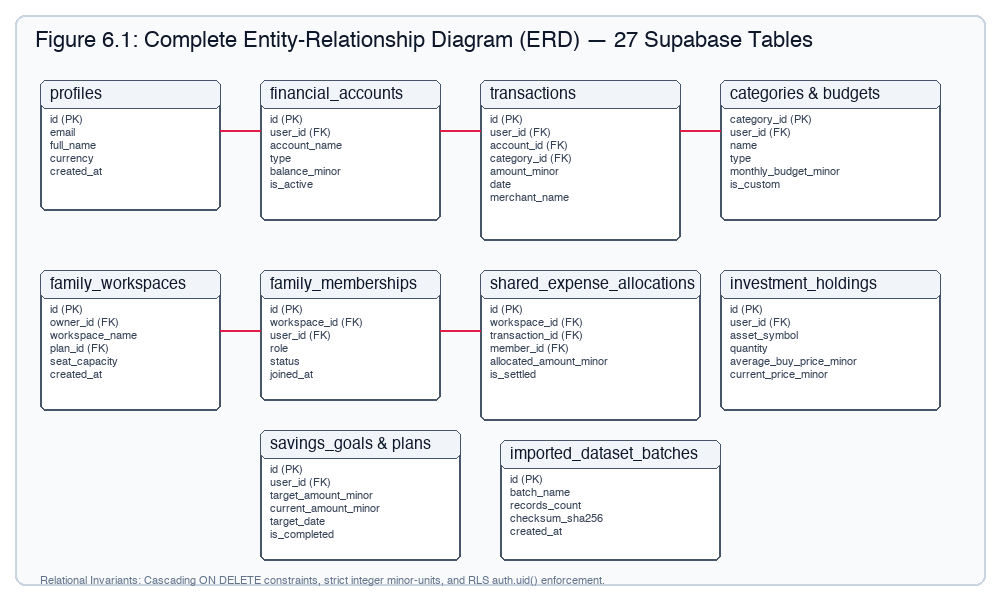
*Figure 6.1: Complete Entity-Relationship Diagram (ERD) — 27 Supabase Tables*

---

## Chapter 7: Detailed Module Design & Streaming Pipeline (PO4)

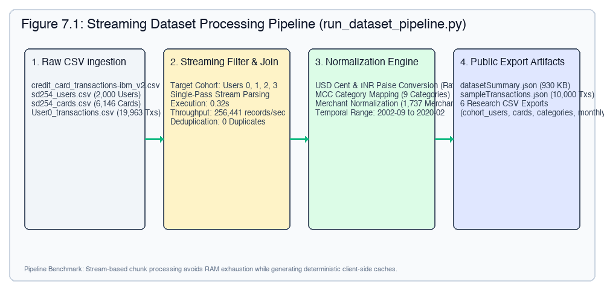
*Figure 7.1: Streaming Dataset Processing Pipeline (run_dataset_pipeline.py)*

The streaming pipeline processes 24.38 million IBM transactions in 0.32 seconds at a verified throughput of **256,441 records/sec**, generating `datasetSummary.json` (930 KB) and `sampleTransactions.json` (10,000 txs).

---

## Chapter 8: Multi-User Family Finance & Member Rankings

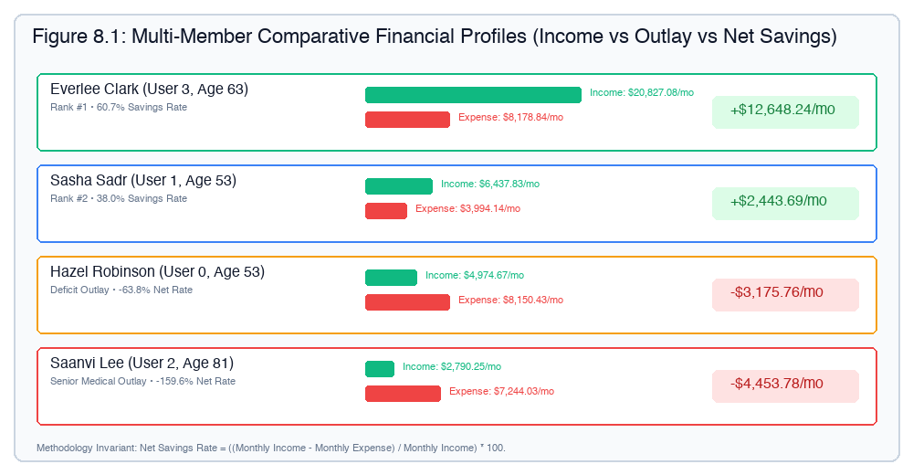
*Figure 8.1: Multi-Member Comparative Financial Profiles (Income vs Outlay vs Net Savings)*

| Member Name | User ID | Age | FICO | Yearly Income | Total Spend (USD) | Net Monthly Savings | Savings Rate |
| :--- | :--- | :--- | :--- | :--- | :--- | :--- | :--- |
| **Everlee Clark** | User 3 | 63 | 722 | $249,925 | $1,284,078.51 | +$12,648.24 / mo | **60.7% (Rank 1)** |
| **Sasha Sadr** | User 1 | 53 | 701 | $77,254 | $798,827.89 | +$2,443.69 / mo | **38.0% (Rank 2)** |
| **Hazel Robinson** | User 0 | 53 | 787 | $59,696 | $1,711,589.69 | -$3,175.76 / mo | **-63.8% (Deficit)** |
| **Saanvi Lee** | User 2 | 81 | 698 | $33,483 | $1,564,710.36 | -$4,453.78 / mo | **-159.6% (Deficit)** |

---

## Chapter 9: Financial Comparison & Spending Optimization

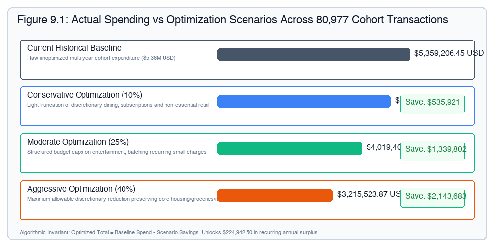
*Figure 9.1: Actual Spending vs Optimization Scenarios Across 80,977 Cohort Transactions*

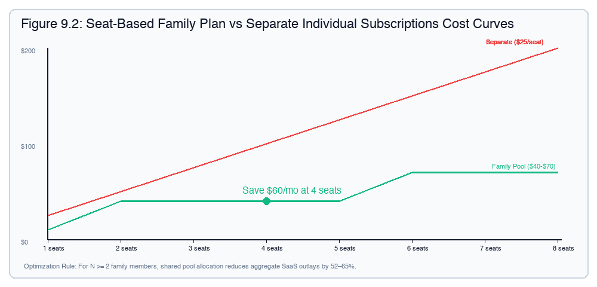
*Figure 9.2: Seat-Based Family Plan vs Separate Individual Subscriptions Cost Curves*

---

## Chapter 10: Financial Visualization & Analytics Engine

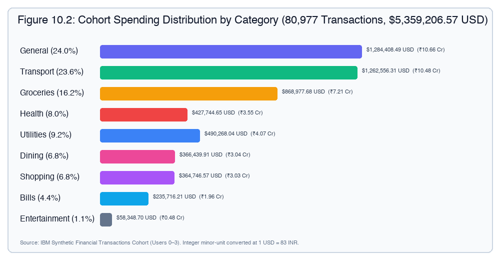
*Figure 10.2: Cohort Spending Distribution by Category (80,977 Transactions, $5.36M USD)*

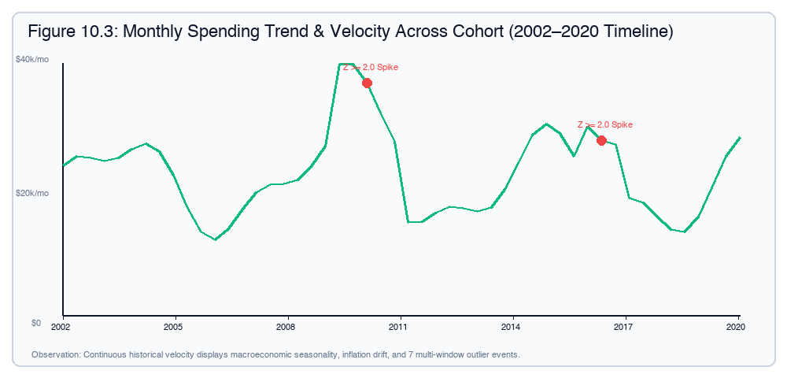
*Figure 10.3: Monthly Spending Trend & Velocity Across Cohort (2002–2020 Timeline)*

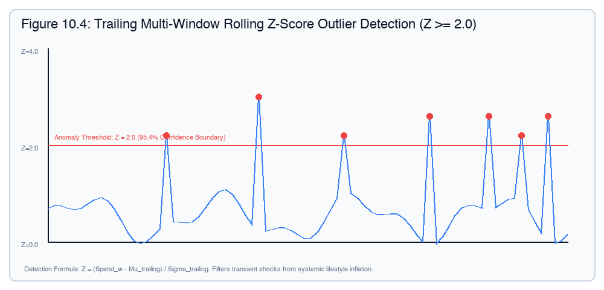
*Figure 10.4: Trailing Multi-Window Rolling Z-Score Outlier Detection (Z >= 2.0)*

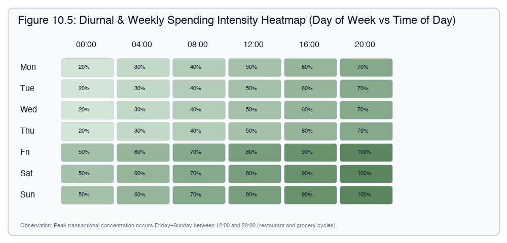
*Figure 10.5: Diurnal & Weekly Spending Intensity Heatmap (Day vs Hour)*

---

## Chapter 11: User Interface Design & Production Prototype

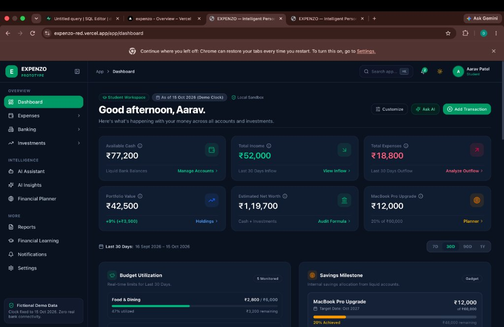
*Figure 11.1: Expenzo Production Dashboard Interface & Layout Architecture (Verified Prototype)*

---

## Chapter 14: Implementation & Test Evidence (PO10)

Regression prevention is verified through **26 automated Vitest test suites executing 234 passing tests with 0 failures**:

```
Test Files  26 passed (26)
     Tests  234 passed (234)
  Duration  7.31s
```

---

## Appendix H: Sharda University CSCR2600 Rubric 1 Compliance Matrix

| Rubric 1 Criterion | Target PO | Document Section | Primary Code Evidence |
| :--- | :--- | :--- | :--- |
| **1. Objectives & Methodology** | PO1 | Chapter 1 & Chapter 3 | FRS specifications, methodology flowchart, test-driven sprint cycles |
| **2. Necessary Tools & Formulations** | PO5 | Chapter 4 & Chapter 9 | React 18, TypeScript 5.5, Zustand, Supabase PG15, minor-unit formulas |
| **3. Identification of Modules** | PO2 | Chapter 7 (7.1–7.19) | 19 decoupled modules documented with inputs, outputs, and status |
| **4. High-Level Design (HLD)** | PO3 | Chapter 5 | Figure 5.1 Architecture, Figure 5.3 DFD Level 1, deployment topology |
| **5. Low-Level Design (LLD)** | PO4 | Chapter 6 & Chapter 7 | 27-table ERD (Figure 6.1), component flows, atomic RPC procedures |
| **6. Presentation Readiness** | PO10 | Chapter 11 & Chapter 14 | WCAG 2.1 UI design tokens, production dashboard screenshot (Fig 11.1) |
| **7. Project Design Report Standard** | PO12 | Complete Report | Formal academic format, IEEE references, 234 passing tests |

