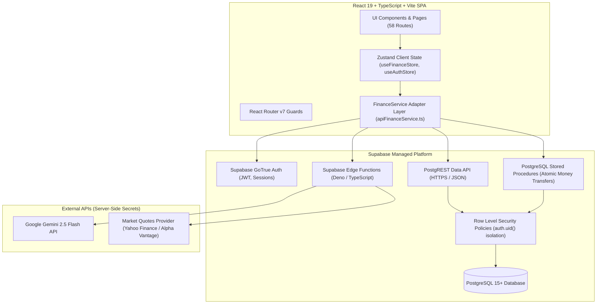

# EXPENZO — Full-Stack Backend Master Execution Plan

**Author:** Principal Full-Stack Engineer, Backend Architect, Security Engineer  
**Architecture:** Supabase Backend (PostgreSQL, Supabase Auth, Row Level Security, RPC Functions, Edge Functions) + React 19 Frontend Adapter Layer.

---

## 1. System Architecture Overview

---

## 2. Inventory of Hardcoded Data Sources & Mock Implementations

| Mock / Hardcoded Artifact | Location in Codebase | Proposed Backend Replacement |
| :--- | :--- | :--- |
| `seedData.ts` (Initial User, Balances, Tx) | `frontend/src/services/fixtures/seedData.ts` | Dynamic user profile and empty initial ledger in PostgreSQL |
| `stockCatalog.ts` (15 Indian Stocks & Quotes) | `frontend/src/features/investments/data/stockCatalog.ts` | `market_price_cache` table + Edge Function quote fetcher |
| `intentRegistry.ts` (12 Offline Intent Rules) | `frontend/src/features/ai/intents/intentRegistry.ts` | Authenticated Supabase Edge Function (`ai-assistant`) calling Gemini API |
| `mockFinanceService.ts` | `frontend/src/services/mocks/mockFinanceService.ts` | Real `apiFinanceService.ts` implementing `FinanceServiceContract` via Supabase |
| Simulated Authentication & Personas | `frontend/src/store/useAuthStore.ts` | Supabase GoTrue Auth (`supabase.auth.signUp`, `signInWithPassword`) |
| LocalStorage Ledger Persistence | `frontend/src/store/useFinanceStore.ts` | Database queries with optimistic updates and cache revalidation |

---

## 3. Application Route to Backend Mapping

All 58 application routes are mapped to their respective database entities and APIs:

| Route Path | Feature | Database Tables Involved | Supabase API / RPC / Edge | Auth Required |
| :--- | :--- | :--- | :--- | :--- |
| `/` | Marketing Homepage | None (Static) | None | No |
| `/features`, `/ai`, `/banking`, `/investments` | Marketing Showcase | None (Static) | None | No |
| `/about`, `/security`, `/contact`, `/privacy`, `/terms`| Marketing Info | None (Static) | None | No |
| `/login`, `/register`, `/forgot-password`, `/reset-password` | Auth Flow | `profiles`, `auth.users` | Supabase GoTrue Auth | No |
| `/verify-email` | Auth Verification | `auth.users` | Supabase Auth verifyOtp | No |
| `/onboarding` | User Setup | `profiles`, `user_preferences` | `profiles` INSERT/UPDATE | Yes |
| `/app/dashboard` | Main Financial Command Center | `financial_accounts`, `transactions`, `budgets` | Data API + aggregations | Yes |
| `/app/expenses` | Expense Breakdown | `transactions`, `categories` | `transactions` SELECT | Yes |
| `/app/expenses/transactions` | Full Ledger View | `transactions`, `financial_accounts` | `transactions` CRUD | Yes |
| `/app/expenses/categories` | Custom Categories | `categories` | `categories` CRUD | Yes |
| `/app/expenses/budgets` | Budget Management | `budgets`, `transactions` | `budgets` CRUD | Yes |
| `/app/expenses/recurring` | Recurring Commitments | `recurring_rules` | `recurring_rules` CRUD | Yes |
| `/app/banking` | Digital Banking Overview | `financial_accounts`, `banking_bills` | Data API | Yes |
| `/app/banking/accounts` | Accounts Directory | `financial_accounts` | `financial_accounts` CRUD | Yes |
| `/app/banking/accounts/:id` | Account Detail & History | `financial_accounts`, `transactions` | `transactions` query | Yes |
| `/app/banking/transfer` | Account-to-Account Transfer | `financial_accounts`, `transactions` | `execute_transfer` RPC | Yes |
| `/app/banking/beneficiaries` | Contact Directory | `banking_beneficiaries` | `banking_beneficiaries` CRUD | Yes |
| `/app/banking/statements` | Bank Statements & Export | `transactions`, `financial_accounts` | Statement Generator | Yes |
| `/app/banking/bills` | Bill Tracker & One-Click Pay | `banking_bills`, `transactions` | `pay_bill` RPC | Yes |
| `/app/banking/cards` | Virtual Cards | `user_cards` | `user_cards` CRUD | Yes |
| `/app/banking/deposits` | Term Deposits (FD/RD) | `deposit_simulations` | `deposit_simulations` CRUD| Yes |
| `/app/banking/loans` | Loan & EMI Calculator | `loan_simulations` | `loan_simulations` CRUD | Yes |
| `/app/banking/services` | Banking Services | None (Informative) | None | Yes |
| `/app/investments` | Portfolio Overview | `investment_holdings`, `market_cache` | Data API + Edge Function | Yes |
| `/app/investments/holdings` | Holdings Management | `investment_holdings` | `investment_holdings` CRUD | Yes |
| `/app/investments/discover` | Stock Discovery & Search | `market_price_cache` | Edge Function `market-data` | Yes |
| `/app/investments/stocks/:symbol`| Stock Detail & Quotes | `market_price_cache` | Edge Function `market-data` | Yes |
| `/app/investments/watchlists` | Watchlists Directory | `watchlists`, `watchlist_items` | `watchlists` CRUD | Yes |
| `/app/investments/analytics` | Portfolio Allocation & Risk | `investment_holdings` | Allocation calculation | Yes |
| `/app/ai-assistant` | Conversational AI Agent | `ai_chat_sessions`, `ai_chat_messages` | Edge Function `ai-assistant` | Yes |
| `/app/ai-insights` | Financial Rule Insights | `transactions`, `budgets`, `accounts` | Insight rules engine | Yes |
| `/app/financial-planner` | Savings Goals | `savings_goals`, `goal_contributions` | `savings_goals` CRUD | Yes |
| `/app/financial-planner/simulator`| What-If Simulator | `user_preferences` | Client calculation | Yes |
| `/app/reports` | Standard Reports | `transactions`, `accounts` | Financial aggregation | Yes |
| `/app/learning` | Financial Education | `user_learning_progress` | Progress persistence | Yes |
| `/app/notifications` | Notifications Center | `notifications`, `user_preferences`| `notifications` CRUD | Yes |
| `/app/settings/*` (7 subpages) | Profile, Privacy, Security, etc.| `profiles`, `user_preferences` | User preferences UPDATE | Yes |

---

## 4. Reusable Code & Invariants
- **Accounting Math (`frontend/src/domain/calculations/accounting.ts`)**: Keep client-side double-entry formulas and transfer neutrality.
- **Money Formatter (`frontend/src/domain/calculations/money.ts`)**: Keep exact minor unit integer paise representation (`amountMinor`).
- **UI Design System**: All 58 pages, modals, dialogs, and components remain visually identical; only their data pipeline switches from localStorage to Supabase.

